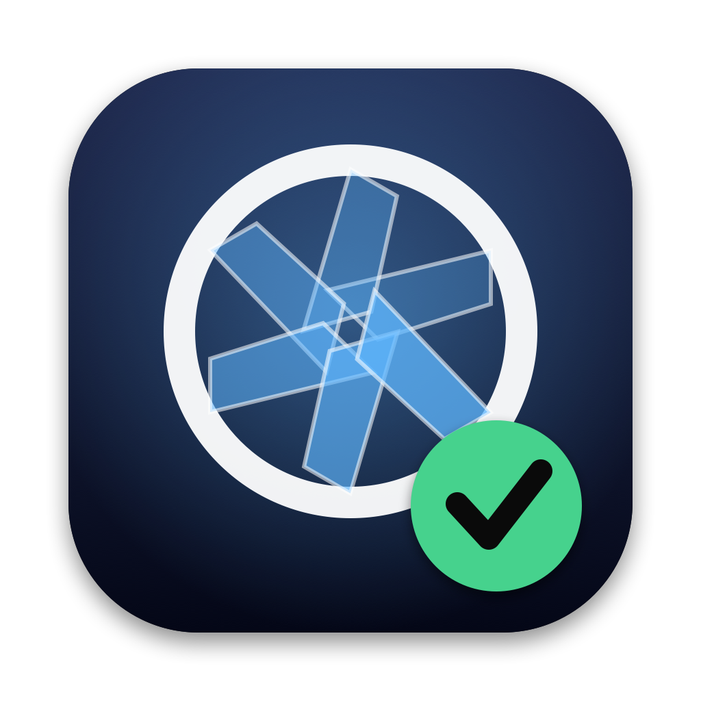
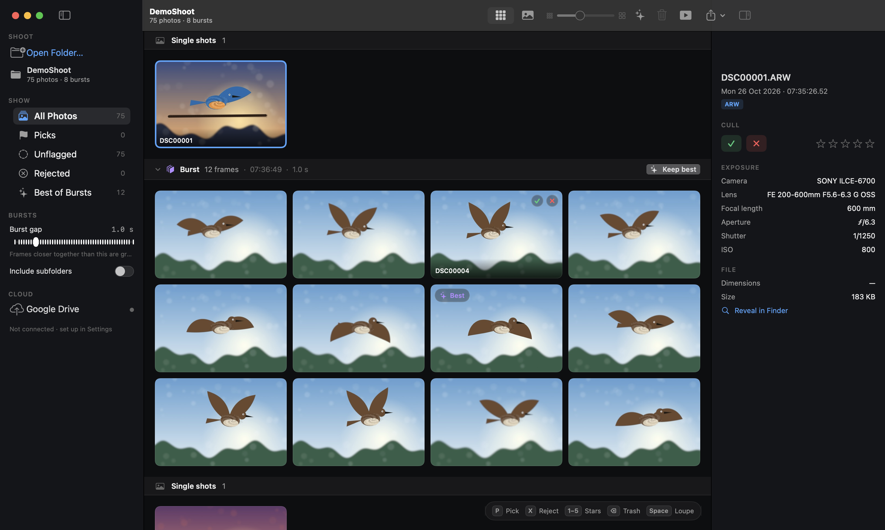
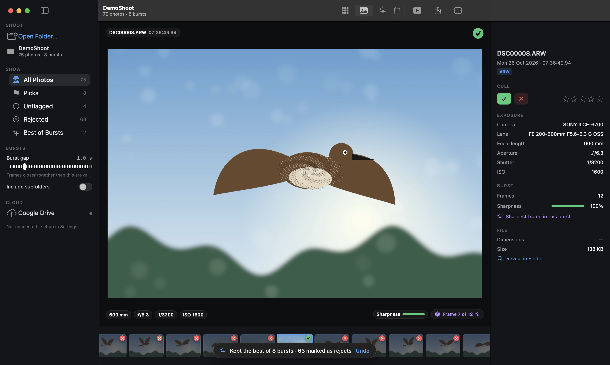
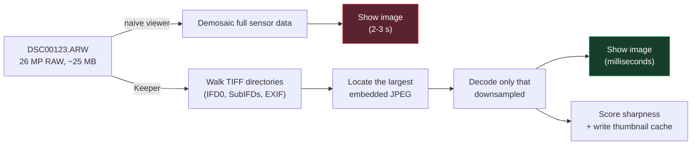
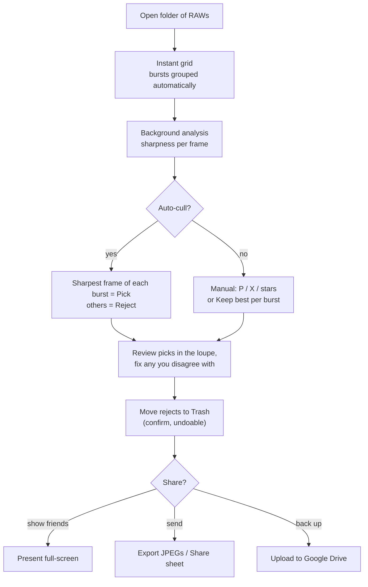
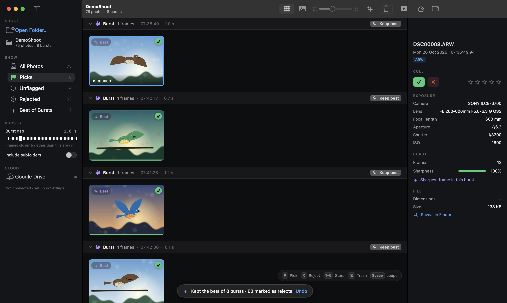
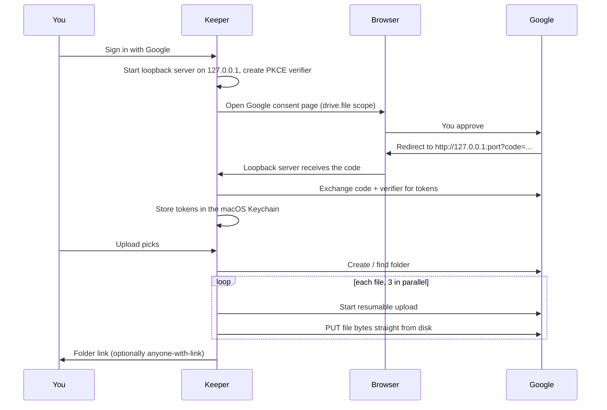
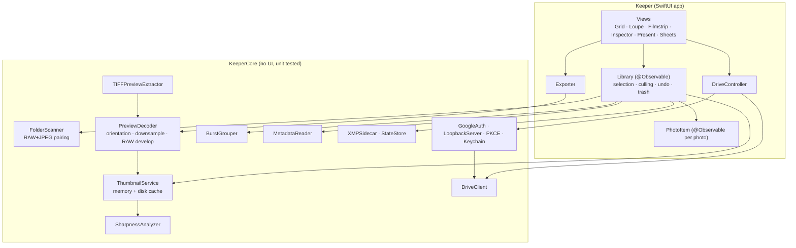

<div align="center">



# Keeper

**Free, open-source RAW photo culler for Mac.**
Instantly preview Sony ARW, Canon, Nikon and other RAW files, group burst shots, find the sharpest frame, delete the rest, and show your RAWs to people without converting them. Works fully offline.

[](https://github.com/pasinduPrabhath/keeper-raw-photo-culler/releases/latest) [](https://github.com/pasinduPrabhath/keeper-raw-photo-culler)   

[**⬇ Download for macOS**](https://github.com/pasinduPrabhath/keeper-raw-photo-culler/releases/latest) · [Privacy](#privacy-works-offline) · [Customize & fork](#customize-and-fork)



</div>

---

## Why this exists

Shooting wildlife with a long lens means holding the shutter down: one decent moment becomes a 14-frame burst, and a morning's shoot becomes 2,000 near-identical RAWs. General photo apps make this miserable, because opening a single 26 MP RAW takes 2–3 seconds while they demosaic it.

Keeper is built for exactly this job:

| Problem | What Keeper does |
|---|---|
| Opening each RAW takes seconds | Reads the full-size JPEG your camera already embedded in every RAW, so frames appear instantly, like PNGs |
| Bursts bury the one good frame | Groups frames by capture time (sub-second EXIF) and badges the **sharpest** one in each burst |
| Deleting hundreds of rejects is tedious | Multi-select, `P`/`X` flags, **Auto-cull** (keep best, reject the rest), then one confirmed move to the Trash, with undo |
| Showing people your RAWs means exporting first | **Present** mode: full-screen slideshow straight from the RAW files, plus one-click JPEG export, Share sheet and Drive upload |

<div align="center">

</div>

## Features

- **Instant RAW browsing.** Parses the TIFF structure of ARW/DNG/NEF/CR2/ORF files directly and decodes only the embedded preview. Thumbnails and sharpness scores are cached on disk, so re-opening a folder is immediate.
- **Multiple folders.** Open several folders at once (⌘-click in the chooser, drop them on the window, or **Add Folder…**). They merge into one timeline, so bursts that span memory cards or days are grouped correctly. Each folder keeps its own saved flags, and "Include subfolders" handles nested folders.
- **Burst detection.** Frames within a configurable gap (default 1 s) form a burst. Bursts are shown as sections with time span and frame count, and can be collapsed to their best frame.
- **Sharpest-frame scoring.** Splits the frame into tiles, measures local contrast (Laplacian variance) and scores the sharpest 5% of tiles. A sharp bird on a creamy blurred background wins, and a motion-blurred or missed-focus frame loses.
- **Zoom to check focus.** Pinch on the trackpad, ⌘/⌥ + scroll, `+`/`-`, or double-click, all anchored on the point under your cursor. Fit / 100% / 200% buttons, drag or two-finger scroll to pan. 100% uses the camera's full-size embedded JPEG, so it is instant.
- **Culling the way you think.** Pick (`P`), Reject (`X`), stars (`1`–`5`), auto-advance, shift/cmd multi-select, rubber-stamp a whole burst with **Keep best** (`K`).
- **Safe deletion.** Rejects (and their RAW+JPEG+XMP siblings) go to the macOS Trash after a confirmation showing the total size. Every flag change and every trash is undoable with `⌘Z`.
- **RAW + JPEG aware.** Pairs `DSC00123.ARW` with `DSC00123.JPG`. When a JPEG exists it is used for previews, so you get full resolution.
- **Present.** Full-screen slideshow with auto-hiding HUD, keyboard navigation and autoplay. RAW-only photos are developed in the background for a sharper picture, after the instant preview shows.
- **Share without editing.** Export JPEGs (camera look *or* developed from RAW, sized 1600 px to full), open the system Share sheet, copy the image, or drag a thumbnail into any app.
- **Google Drive upload.** Sign in once; upload originals, JPEG previews or both into a folder, skip files already uploaded, and copy an "anyone with the link" URL. See [Google Drive setup](docs/GOOGLE_DRIVE_SETUP.md).
- **Lightroom-friendly.** Optionally writes ratings, green "pick" labels and rejects (−1) to XMP sidecars, patching existing ones without touching your develop settings.
- **Native and fluid.** SwiftUI + Core Graphics, lazy grid, prefetching, no Electron, no dependencies.

## How it stays fast



If a RAW has no TIFF-readable preview (for example Canon CR3 or Fuji RAF), Keeper falls back to ImageIO's own RAW path. That works, but it is slower.

## The culling workflow



<div align="center">

<br><sub>After Auto-cull: the 8 sharpest frames out of 71 burst shots.</sub>
</div>

## Install

### Download (easiest)

1. Grab **`Keeper-x.y.z.dmg`** (or the `.zip`) from the [latest release](https://github.com/pasinduPrabhath/keeper-raw-photo-culler/releases/latest).
2. Open the DMG and drag **Keeper** into **Applications**.
3. The first time, **right-click Keeper → Open → Open**. The app is not notarized by Apple (that costs $99/year), so macOS asks once. If macOS says the app "is damaged", run:

   ```bash
   xattr -dr com.apple.quarantine /Applications/Keeper.app
   ```

Requires **macOS 14 (Sonoma) or later**, Apple Silicon or Intel.

### Build from source

Requires the Xcode command-line tools (Swift 5.10+).

```bash
git clone https://github.com/pasinduPrabhath/keeper-raw-photo-culler.git
cd keeper-raw-photo-culler
./Scripts/build-app.sh --run        # builds dist/Keeper.app (ad-hoc signed) and opens it
```

Or work from the command line:

```bash
swift run -c release Keeper         # run without making an .app
swift test                          # run the unit tests
```

### Try it without a camera

```bash
swift run -c release KeeperDemoGen ./DemoShoot       # writes 75 fake ARW files in 12 bursts/singles
open dist/Keeper.app                  # then drop the ./DemoShoot folder onto the window (or ⌘O)
```

`KeeperDemoGen` writes TIFF-structured files with a JPEG preview and real EXIF (including sub-second times), so everything in the app behaves as it does with real RAWs. Add `--pairs` to also write a camera-style `.JPG` next to each file.

## Keyboard shortcuts

| Key | Action | Key | Action |
|---|---|---|---|
| `←` `→` `↑` `↓` | Move | `Space` / `↩` | Grid ⇄ Loupe |
| `⇧` + arrows | Extend selection | `Z` | Toggle 100% zoom (loupe) |
| `⌘O` / `⇧⌘O` | Open folders / add a folder |
| `⌘A` | Select all | `P` | Pick |
| `X` | Reject | `U` | Clear flag |
| `1`–`5`, `0` | Stars / clear | `K` | Keep best of this burst |
| `B` | Collapse/expand burst | `[` `]` | Previous / next burst |
| `⌫` | Move selection to Trash… | `⌘Z` | Undo |
| `⌘↩` | Present | `⌘E` | Export JPEGs… |
| `⌘U` | Upload to Drive… | `I` | Toggle inspector |
| `⌘K` | Auto-cull all bursts | `⌘C` | Copy image |
| `+` / `-` | Zoom in / out (loupe) | `⌘0` `⌘1` `⌘2` | Fit / 100% / 200% |

While presenting: `←` `→` `Space` navigate, `A` toggles autoplay, `I` toggles the caption, `Esc` exits.

## Google Drive



Keeper requests only the **`drive.file`** scope. It can see only files and folders it created, never the rest of your Drive. Tokens live in your Keychain. You bring your own free OAuth client; the 5-minute walkthrough is in [docs/GOOGLE_DRIVE_SETUP.md](docs/GOOGLE_DRIVE_SETUP.md).

## Architecture



```
Sources/
  KeeperCore/     Pure logic. Imaging/ (preview extraction, sharpness, cache), Library/ (scanner, bursts, XMP), Drive/
  Keeper/         The app. Models/ (Library, PhotoItem), Views/, Services/ (Drive, Export, dev snapshot runner)
  KeeperDemoGen/  Synthetic-shoot generator for demos and tests
Tests/            21 unit tests for the core library
Scripts/          build-app.sh, package-release.sh, make-icon.swift
```

Design notes:
- Per-photo `@Observable` objects mean flagging one frame redraws one thumbnail, not the grid.
- Thumbnail requests from visible cells jump ahead of the background analysis queue and share in-flight work, so the same file is never decoded twice.
- Culling state (flags, stars) is stored per folder in `~/Library/Application Support/Keeper`, never inside your photo folders, unless you enable XMP sidecars.

## Supported formats

| Format | Preview path |
|---|---|
| Sony ARW/SR2, Adobe DNG, Nikon NEF/NRW, Canon CR2, Olympus ORF, Pentax PEF, Samsung SRW, Hasselblad 3FR… | Direct TIFF parse (fast) |
| Canon CR3, Fujifilm RAF, Panasonic RW2 | Embedded-JPEG scan (fast, **untested on real files**), then ImageIO fallback (slower) |
| JPEG, HEIC, PNG, TIFF | Decoded directly |

## Status and honest limitations

- Verified on real **Sony A6700 ARW** files (24 photos opened and analysed in about 2 s on an Apple Silicon Mac); the unit tests also use synthetic ARW-style files, including a regression test for the A6700's lossless sensor-data stream. **Other camera models are untested**; if a RAW shows a black or sideways preview, or falls back to the slow path, please open an issue with the camera model.
- Sharpness scoring is a heuristic. It ranks frames within one burst well but is not an eye/subject detector, and very high ISO noise can inflate scores. Always glance at the picks.
- The Drive integration is written against the documented REST/OAuth APIs but has not been exercised against a live account yet. Uploads are whole-file PUTs with retry, not chunk-resumable across app restarts.
- Developed-RAW rendering (Present / Export) uses Apple's RAW engine, so colours look neutral rather than like your in-camera JPEG style.
- Builds are ad-hoc signed (not notarized).

## Roadmap

- [ ] Eye/subject-aware focus scoring (Vision framework)
- [ ] Side-by-side compare of burst frames
- [ ] Focus-point overlay from Sony MakerNotes
- [ ] Notarized releases and a Homebrew cask (releases are ad-hoc signed for now)
- [ ] Tethered/watch-folder mode for live shoots

## Privacy: works offline

Keeper is built to be safe to use on unreleased or private work.

- **Your photos never leave your computer unless you upload them.** Photos, thumbnails, flags and metadata are processed locally. There is no analytics, no telemetry, no crash reporting, no update check and no account.
- **Only two optional features touch the network**, both off until you use or allow them, and both auditable:
  1. **Google Drive upload** ([`Sources/KeeperCore/Drive`](Sources/KeeperCore/Drive)) does nothing until *you* connect an account and press Upload.
  2. **Update check** ([`UpdateService.swift`](Sources/Keeper/Services/UpdateService.swift)) makes one plain request to GitHub's public "latest release" page and, only if you click **Install & Restart**, downloads the release `.zip` and checks its SHA-256. It sends no identifiers, no analytics and nothing about your photos. Turn it off in **Settings → General → Updates** and Keeper makes no connection at all.
  Those are the only places that use `URLSession` or open a socket.
- **Where data is stored:** thumbnails in `~/Library/Caches/Keeper`, flags and stars in `~/Library/Application Support/Keeper` (or optionally XMP sidecars next to your photos), Google tokens (if you connect) in the macOS Keychain.
- **Don't take our word for it:** build it yourself, or block the app with a firewall such as Little Snitch or LuLu and watch nothing happen. Delete `Sources/KeeperCore/Drive` and `UpdateService.swift` (and their menu items) for a build that physically cannot go online.

## Customize and fork

Keeper is MIT licensed: fork it, change it, ship your own version.

1. **Fork** the repo ([fork it here](https://github.com/pasinduPrabhath/keeper-raw-photo-culler/fork)) and clone your fork.
2. Open the folder in Xcode (`File → Open…` on `Package.swift`) or just use `swift build`.
3. Common tweaks:

| I want to… | Edit |
|---|---|
| Change colours, spacing, fonts | `Sources/Keeper/Theme.swift` |
| Change shortcuts | `handleKey` in `Sources/Keeper/Views/RootView.swift`, menus in `KeeperApp.swift` |
| Change how bursts are grouped (default 1 s gap) | `burstGap` in `Library.swift`, `Library/BurstGrouper.swift` |
| Change how "sharpest" is scored | `Sources/KeeperCore/Imaging/SharpnessAnalyzer.swift` |
| Support another RAW format | `FileTypes.raw`, `Imaging/TIFFPreviewExtractor.swift` |
| Change the app name, icon, bundle ID | `Resources/Info.plist`, `Scripts/make-icon.swift`, `Scripts/build-app.sh` |
| Use your own Google Drive client | [docs/GOOGLE_DRIVE_SETUP.md](docs/GOOGLE_DRIVE_SETUP.md) |

4. `swift test`, then `./Scripts/build-app.sh --run`.
5. To publish your own build: `VERSION=1.1.0 ./Scripts/package-release.sh` makes a `.dmg` and `.zip`. Pushing a tag like `v1.1.0` makes GitHub Actions build and attach them to a release automatically, and running copies of Keeper will offer it as an in-app update (point `UpdateService.repo` at your fork).

Pull requests are welcome; see [CONTRIBUTING.md](CONTRIBUTING.md).

## Like it? Give it a star ⭐

Keeper is free and built by one wildlife photographer. If it saved you time culling a shoot, **[star the repo on GitHub](https://github.com/pasinduPrabhath/keeper-raw-photo-culler)**. It helps other photographers find it, and it tells me to keep going. Bug reports (especially with your camera model) and ideas are just as valuable: [open an issue](https://github.com/pasinduPrabhath/keeper-raw-photo-culler/issues).

## Keywords

RAW photo culler for Mac, fast RAW viewer, Sony ARW viewer, Sony A6700, Canon CR2 CR3 viewer, Nikon NEF viewer, burst photo culling, wildlife photography workflow, pick and reject photos, find sharpest photo in burst, photo culling software, Photo Mechanic alternative, Lightroom culling alternative, open source, offline, Swift, SwiftUI.

## License

[MIT](LICENSE)
